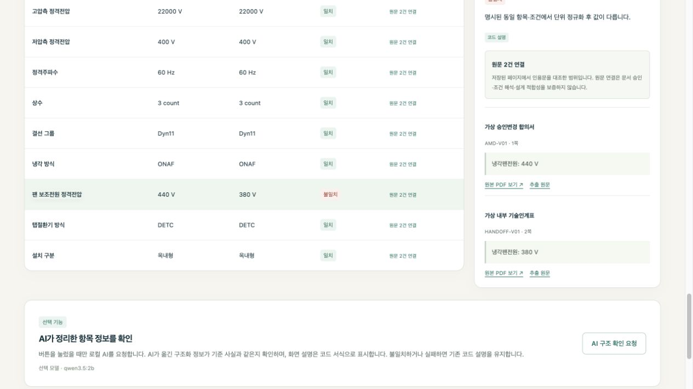

# 변압기 수주 기술사양 검토 AI

고객 사양서와 승인 변경 합의서의 요구사항이 내부 기술 인계표에 반영됐는지 확인하는 로컬 웹 프로토타입입니다. **수주 확정 후 기술 인계회의 전**에 사용하며, 담당자가 원문을 확인하고 최종 판단하도록 지원합니다.

## 주요 기능

- **PDF 근거 추출** — 텍스트 AI 모드에서 고객 사양서·변경 합의서·내부 인계표의 사양값과 근거를 로컬 AI가 제안합니다. 정형 예시는 코드만 사용합니다.
- **변경 누락과 불일치 검토** — 담당자가 확인한 변경 적용 순서에 따라 기술사양 10개를 비교합니다.
- **고객사 혼입 방지** — 지정 별칭을 확인하고 고객사가 다르거나 불명확하면 비교를 보류합니다.
- **원문 근거 확인** — 요구값·인계값과 함께 문서명·페이지·인용문·원본 PDF를 연결합니다.
- **검토 기록 관리** — 결과를 저장·복원하고 담당자 확인 후 JSON으로 내려받습니다.
- **회의용 보고서** — 저장된 판정과 원문 근거를 읽기 전용 보고서로 열고 브라우저에서 인쇄합니다. PDF 저장 지원 여부는 브라우저에 따릅니다.

[최종 보고서 PDF](output/pdf/final-report.pdf)에 문제, 구현 구조, 실제 시연 화면, 검증 결과와 한계를 정리했습니다.

[발표자료 PowerPoint](output/presentations/transformer-spec-review-presentation.pptx)는 16장으로 구성했으며 실제 코드 설명 4장과 슬라이드별 발표자 노트를 포함했습니다.

지원 항목은 정격용량, 고압측 전압, 저압측 전압, 주파수, 상수, 결선 그룹, 냉각 방식, 팬 보조전원 전압, 탭절환기 방식, 옥내형·옥외형입니다.

## 대표 시연

가상 변경 합의서에는 팬 전원이 **440 V**인데 인계표에는 **380 V**가 남아 있는 사례입니다. 앱은 이를 불일치로 표시하고 양쪽 원문을 연결합니다.



[3분 발표 대본과 시연 순서](docs/presentation-demo.md)에는 실제 버튼 순서, 연결 실패 시 대체 진행 방법, 핵심 질의응답을 정리했습니다.

[핵심 코드 설명](docs/code-walkthrough.md)과 [과제 조건 및 제출 점검표](docs/course-requirements.md)에서 구현 근거와 남은 제출 절차를 확인할 수 있습니다.

## 실행 방법

Python 3.11 이상에서 다음 명령을 실행합니다. 아래 명령은 macOS·Linux 기준입니다.

```sh
git clone https://github.com/seogdo/transformer-spec-review.git
cd transformer-spec-review
python3 -m venv .venv-app
.venv-app/bin/python -m pip install -r requirements-app.txt
.venv-app/bin/python scripts/run_web.py
```

브라우저에서 [http://127.0.0.1:8765](http://127.0.0.1:8765)를 엽니다.

1. **예시 01 · 변경 검토** 등 정형 PDF 예시를 선택합니다. 정형 경로는 AI 서버 없이 실행할 수 있습니다.
2. 고객사 확인 결과와 적용할 변경 문서를 확인합니다.
3. 기준 확인란을 체크하고 **10개 항목 검토하기**를 누릅니다.
4. 불일치 항목의 원문을 확인하고 사람 검토 확인란을 체크합니다.
5. **회의용 보고서 열기** 또는 **검토 기록 내려받기**를 선택합니다. 보고서의 **인쇄 · PDF로 저장**은 브라우저 인쇄 메뉴를 사용하며, AI를 다시 호출하거나 저장된 판정을 변경하지 않습니다.

텍스트 PDF의 AI 추출에는 별도로 준비한 Ollama와 `qwen3.5:2b`가 필요합니다. 기본 연결 주소는 `http://127.0.0.1:11434`입니다. 앱은 모델을 자동 설치하지 않으며 API 키나 외부 AI API를 사용하지 않습니다. **V01·V02·V03** 예시는 문서를 읽은 뒤 **AI로 근거 찾고 항목 추출**을 눌러 사용합니다.

## 처리 구조

PDF 읽기 → 고객사 확인 → AI 검색 계획 → 키워드·별칭 근거 검색 → AI 값 제안 → 코드의 원문 대조 → 담당자의 변경 적용 확인 → 사양 비교

AI는 정상 추출 경로에서 최대 2회 호출됩니다. 비교와 단위 정규화는 코드가 수행하며, 출처가 부족하거나 값이 모호하면 `확인 필요`로 남깁니다. 모델이 제안한 값을 그대로 확정하지 않습니다.

현재 검색은 키워드·지정 별칭 기반입니다. 벡터 RAG, MCP, 네이티브 도구 호출을 구현한 것은 아닙니다.

## 검증

```sh
# 자동 회귀 검사
.venv-app/bin/python -m unittest discover -s tests -v

# 화면 코드의 모의 DOM 검사 — Node.js 필요
node scripts/check_evidence_ui.cjs
node scripts/check_recovery_ui.cjs
node scripts/check_report_ui.cjs

# 구조화된 가상 개발 사례 평가
PYTHONPATH=src .venv-app/bin/python scripts/evaluate_cases.py

# F04의 이전 저장 결과와 현재 코드의 고정 응답 재생 비교
# 실제 모델 연결 없이 임시 저장소에서 실행하며 새 결과 JSON을 만듭니다.
.venv-app/bin/python scripts/measure_evidence_before_after.py
```

개발 환경에서 V01 가상 PDF 3개로 실제 AI 추출값 21개가 원문 대조를 통과했고, 9개 일치·1개 불일치를 확인했습니다. 원문 PDF 열기, JSON 내려받기, 새로고침 후 결과 복원도 확인했습니다. PDF 뷰어 다운로드 버튼의 완료 여부는 미확인입니다.

추가 실제 AI 화면 시험에서 V02는 9개 일치·1개 확인 필요, V03는 8개 일치·2개 불일치였습니다. V03 회의용 보고서를 Chrome에서 PDF 9쪽으로 저장하고 전체 페이지와 원문 인용 20개를 확인했습니다. 보고서 조회·인쇄 전후 저장 파일 22개는 변경되지 않았습니다.

최종 보완 후 Python 자동 검사 376개와 모의 DOM 검사 58개(근거 12·복구 32·보고서 14)가 통과했습니다.

F04의 [제한된 전후 측정](reports/evidence-before-after-20261020T111053Z-4e8705ae.json)에서는 같은 PDF와 저장 모델 응답을 사용해 충돌 근거 표시가 1개에서 2개로 보완되고 10항목 판정·정규화값이 보존됨을 확인했습니다. 이전은 당시 저장 결과이며 이후만 현재 코드로 재생했습니다. 실제 모델 호출은 0회로, 구버전 코드의 재실행이나 AI 정확도·속도 비교는 아닙니다.

자동 검사와 실제 모델 시험은 구분합니다. 가상 개발 사례의 성공을 실제 회사 문서 정확도나 독립 성능 평가로 해석하지 않습니다. [공개 사본의 구성 및 검증 안내](docs/publication.md)를 확인해 주세요.

파일 오류·AI 연결 실패·접수 후 응답 오류의 [재시도 흐름](docs/error-recovery.md)도 확인했습니다. 같은 추출 요청은 기존 작업을 다시 조회하며, 실패한 값을 성공한 값으로 대신 채우지 않습니다.

## 지원 범위와 제한

- 명시적인 가상 자료 선언과 지정 메타데이터가 있는 **텍스트 PDF 3종**만 지원합니다. 제공 샘플로 실행할 수 있습니다.
- 파일당 5 MiB·20쪽 제한이 있으며, 스캔·OCR·도면·다제품 문서는 지원하지 않습니다.
- 고객사는 지정 후보·별칭의 일치 여부만 확인합니다. 실제 거래 관계나 법인 동일성을 인증하지 않습니다.
- 승인 상태는 데모 메타데이터입니다. 실제 승인 권한·문서 진위·전기적 설계 적합성·제품 안전을 보증하지 않습니다.
- 자동 승인·발주·설비 제어를 수행하지 않습니다.
- 인증과 공개 서비스용 보안 구성이 없는 **로컬 전용 앱**입니다. 저장소 공개가 웹 서비스 공개 배포를 의미하지 않습니다.

## 저장소 구성

| 폴더 | 내용 |
| --- | --- |
| `src/handoff_review/` | PDF 처리·AI 추출·규칙 판정·웹 API |
| `web/` | 별도 빌드 없는 HTML·CSS·JavaScript 화면 |
| `tests/` | 자동 회귀 검사 |
| `fixtures/` | 가상 개발 사례와 수동 정답 |
| `output/pdf/` | 최종 보고서와 가상 시연·검증 PDF |
| `output/presentations/` | 코드 설명과 발표자 노트를 포함한 발표자료 |
| `reports/` | 회귀 검사에 필요한 비식별 응답 사본 |
| `scripts/` | 실행·샘플 생성·평가 도구 |

회사 문서·강의 원본·API 키·모델 가중치·개인 업로드 저장소는 포함하지 않습니다.
