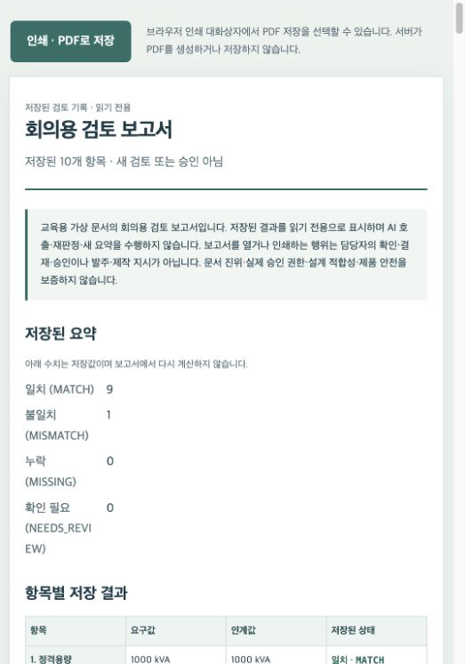

# 변압기 수주 기술사양 검토 AI

고객 사양서와 승인 변경 합의서의 요구사항이 내부 기술 인계표에 반영됐는지 확인하는 로컬 웹 프로토타입입니다. **수주 확정 후 기술 인계회의 전**에 사용하며, 담당자가 원문을 확인하고 최종 판단하도록 지원합니다.

## 주요 기능

- **PDF 근거 추출** — 텍스트 AI 모드에서 고객 사양서·변경 합의서·내부 인계표의 사양값과 근거를 AI가 제안합니다. 서버 시작 시 OpenAI API 또는 로컬 Ollama를 선택합니다. 정형 예시는 코드만 사용합니다.
- **변경 누락과 불일치 검토** — 담당자가 확인한 변경 적용 순서에 따라 기술사양 10개를 비교합니다.
- **고객사 혼입 방지** — 지정 별칭을 확인하고 고객사가 다르거나 불명확하면 비교를 보류합니다.
- **원문 근거 확인** — 요구값·인계값과 함께 문서명·페이지·인용문·원본 PDF를 연결합니다.
- **검토 기록 관리** — 결과를 저장·복원하고 담당자 확인 후 JSON으로 내려받습니다.
- **회의용 보고서** — 저장된 판정과 원문 근거를 읽기 전용 보고서로 열고 브라우저에서 인쇄합니다. PDF 저장 지원 여부는 브라우저에 따릅니다.

> **최종 실행 기준:** OpenAI API의 **`gpt-4o-mini`**로 가상 문서를 실제 검증했습니다. [OpenAI 실행 요약](reports/openai-validation-20261021.json)과 새 캡처를 사용하며, 과거 Ollama F01~F06·V01~V03 및 F04 고정 응답 재생은 별도 이력으로 보존합니다. 자동검사 통과나 API 요청 성공을 AI 정확도로 부르지 않습니다.

[보고서 PDF](output/pdf/final-report.pdf)는 **G077 문성도 / 과제 2**의 제출 자료입니다. 주제와 주요 task, 사용 기술, 기능 화면과 실행 캡처, 검증의 한계, 느낀 점과 향후 개선 내용을 확인합니다.

[발표자료 PowerPoint](output/presentations/transformer-spec-review-presentation.pptx)는 **본 발표 9장과 부록 9장, 총 18장**이며 발표자 노트를 포함합니다. 앞 2분에는 1~4장의 주제·주요 task·결과를, 뒤 3분에는 5~9장의 실행 흐름·검색·검증·비교·의존성 주입 코드를 설명합니다. 느낀 점과 한계는 결과 화면에서 말로 정리하며, 회의용 보고서·상세 검증·전후 비교 등은 부록으로 구분합니다.

지원 항목은 정격용량, 고압측 전압, 저압측 전압, 주파수, 상수, 결선 그룹, 냉각 방식, 팬 보조전원 전압, 탭절환기 방식, 옥내형·옥외형입니다.

## 대표 시연

가상 변경 합의서에는 팬 전원이 **440 V**인데 인계표에는 **380 V**가 남아 있는 사례입니다. 앱은 이를 불일치로 표시하고 양쪽 원문을 연결합니다.



위 이미지는 저장된 OpenAI 결과보고서의 상단 캡처입니다. 메인 검토 화면이나 보고서 전체가 아니며, 팬 전원값과 양쪽 인용문은 이 캡처에 보이지 않습니다. 상세 값은 [공개 실행 기록](reports/openai-validation-20261021.json)에서 확인할 수 있습니다.

V01은 실제 API 요청 2회가 모두 완료됐고 21개 추출값이 원문 검증을 통과했습니다. 최종 10항목은 9개 일치·1개 불일치입니다. 이는 가상 문서 한 사례의 실행 결과이며 실제 회사 문서 정확도 측정이 아닙니다.

[5분 발표 대본과 시연 순서](docs/presentation-demo.md)는 저장된 실제 실행 캡처를 주 자료로 사용합니다. 실시간 AI 추출은 시간이 허용될 때만 별도로 진행하며, 과거 캡처를 실시간 결과로 소개하지 않습니다.

[핵심 코드 설명](docs/code-walkthrough.md)과 [과제 조건 및 제출 점검표](docs/course-requirements.md)에서 구현 근거와 남은 제출 절차를 확인할 수 있습니다.

## 실행 방법

Python 3.11 이상에서 다음 명령을 실행합니다. 아래 명령은 macOS·Linux 기준입니다.

```sh
git clone https://github.com/seogdo/transformer-spec-review.git
cd transformer-spec-review
python3 -m venv .venv-app
.venv-app/bin/python -m pip install -r requirements-app.txt
.venv-app/bin/python scripts/run_web.py --backend openai
```

브라우저에서 [http://127.0.0.1:8765](http://127.0.0.1:8765)를 엽니다.

1. **예시 01 · 변경 검토** 등 정형 PDF 예시를 선택합니다. 정형 경로는 AI 서버 없이 실행할 수 있습니다.
2. 고객사 확인 결과와 적용할 변경 문서를 확인합니다.
3. 기준 확인란을 체크하고 **10개 항목 검토하기**를 누릅니다.
4. 불일치 항목의 원문을 확인하고 사람 검토 확인란을 체크합니다.
5. **회의용 보고서 열기** 또는 **검토 기록 내려받기**를 선택합니다. 보고서의 **인쇄 · PDF로 저장**은 브라우저 인쇄 메뉴를 사용하며, AI를 다시 호출하거나 저장된 판정을 변경하지 않습니다.

**V01·V02·V03** 예시는 문서를 읽은 뒤 **AI로 근거 찾고 항목 추출**을 눌러 사용합니다. AI 호출에는 아래 선택한 방식의 준비가 필요합니다. 문서 읽기·저장 기록 조회·회의 보고서 열기만으로 AI를 호출하지 않습니다.

### OpenAI API — 최종 제출용

1. 저장소의 `.env.example`을 로컬에서 `.env`로 복사합니다. `OPENAI_API_KEY`에 본인 키를, `OPENAI_MODEL`에 본인 계정에서 사용할 모델을 설정합니다. 키를 채팅·브라우저·발표자료에 넣거나 Git에 올리지 마세요. `.env`는 저장소에서 제외됩니다.
2. `.venv-app/bin/python scripts/run_web.py --backend openai`로 실행합니다. 웹 화면에 **OpenAI API**와 설정 상태가 표시됩니다. 키·모델 설정 확인은 실제 접속·잔액·모델 접근 권한 확인과 다릅니다.
3. 가상 PDF 예시를 읽고 **외부 전송·과금 확인**을 직접 체크한 뒤 AI 추출을 실행합니다. 추출 시 문서 식별자·검색어와 검색된 원문 구간이 OpenAI로 전송됩니다. 선택 설명 기능은 비교값·상태·출처 식별자를 전송합니다. 실제 회사 문서·기밀·개인정보는 사용하지 않습니다.

모델명은 자동 선택하지 않습니다. 이번 제출 검증에는 `gpt-4o-mini`를 명시해 사용했으며, 다른 계정이나 이후 실행의 모델 접근 권한·성공을 보장하지 않습니다. 이 앱은 Chat Completions와 Structured Outputs를 지원하는 모델이 필요합니다. 연결 방식은 [OpenAI 구조화 출력 안내](https://developers.openai.com/api/docs/guides/structured-outputs)와 [서버 측 인증 안내](https://developers.openai.com/api/reference/overview#authentication)를 따릅니다.

서버 환경변수가 `.env`보다 우선하며, `--backend`가 `LLM_BACKEND`보다 우선합니다. 어느 쪽도 지정하지 않고 `scripts/run_web.py`로 실행하면 OpenAI 모드입니다. 라이브러리 직접 호출의 기존 기본값은 Ollama로 유지하므로, 제출 시에는 위의 명시적인 실행 명령을 사용하세요. 설정 파일은 단순 `이름=값`만 지원하며 셸 명령이나 변수 치환을 실행하지 않습니다.

**추출은 최대 2회·전체 90초, 선택 설명은 별도 1회입니다. 자동 재시도와 다른 제공업체로의 자동 전환은 없습니다.** 실제 호출에는 비용이 발생할 수 있고, 실패한 요청도 비용이 발생할 수 있습니다. 이 앱은 실제 청구 금액을 계산하지 않습니다. 서버는 로컬 주소에서만 열리고, 키는 서버에서만 사용합니다.

### Ollama — 로컬 테스트용

```sh
.venv-app/bin/python scripts/run_web.py --backend ollama
```

같은 웹 화면이 **Ollama**와 로컬 모델을 표시합니다. 기본 모델은 `qwen3.5:2b`, 연결 주소는 `http://127.0.0.1:11434`입니다. 선택한 방식에 따라 AI 연결과 안내만 달라지고 비교·근거 검증 코드는 동일합니다. 실행 중인 서버의 방식을 바꾸려면 해당 서버를 종료한 뒤 다시 실행합니다. 다른 프로세스를 자동 종료하거나 저장 기록을 지우지 않습니다.

이 구성은 강의 ZIP의 `LLM_BACKEND=ollama/openai` 선택과 동일한 원칙입니다. ZIP 원본도 서로 다른 두 HTML 페이지가 아니라, 같은 화면이 `/health`에서 실행 중인 백엔드를 확인하는 구조입니다. [상세 실행·제출 확인](docs/ai-backends.md)을 참고하세요.

### 로컬 AI 준비와 연결 확인

1. [Ollama 공식 설치 안내](https://docs.ollama.com/quickstart)에 따라 설치합니다. macOS에서는 Ollama 앱을 실행합니다. 서버가 실행되지 않은 환경에서는 별도 터미널에서 `ollama serve`를 실행한 채 유지합니다. 이미 실행 중인 서버를 중복으로 켤 필요는 없습니다.
2. 아래 명령으로 모델을 내려받고, 설치 목록과 로컬 서버 응답을 확인합니다. 최초 다운로드에는 인터넷 연결과 모델을 저장할 디스크 공간이 필요합니다.

```sh
ollama pull qwen3.5:2b
ollama ls
curl --fail http://127.0.0.1:11434/api/tags
```

목록과 응답의 `models`에 `qwen3.5:2b`가 있는지 확인합니다. 서버 연결에 실패하면 Ollama 실행 상태를, 모델이 없으면 다운로드 완료 여부를 확인합니다. 명령과 모델 정보는 [공식 CLI 안내](https://docs.ollama.com/cli), [모델 목록 API](https://docs.ollama.com/api/tags), [모델 페이지](https://ollama.com/library/qwen3.5:2b)를 기준으로 정리했습니다.

3. 웹 앱에서 **V01 · 텍스트 문서**로 AI 추출을 한 번 실행합니다. 서버 응답과 설치 목록 확인만으로 추출 성공까지 보장되지는 않습니다. 앱 화면의 서버 연결 표시도 AI 모델 준비 완료와는 별개입니다. 추출 실패 시 안내를 확인하고, 비교 기능만 확인하려면 AI가 필요 없는 **예시 01 · 변경 검토**를 사용합니다.

## 처리 구조

PDF 읽기 → 고객사 확인 → AI 검색 계획 → 키워드·별칭 근거 검색 → AI 값 제안 → 코드의 원문 대조 → 담당자의 변경 적용 확인 → 사양 비교

AI는 정상 추출 경로에서 최대 2회 호출됩니다. 비교와 단위 정규화는 코드가 수행하며, 출처가 부족하거나 값이 모호하면 `확인 필요`로 남깁니다. 모델이 제안한 값을 그대로 확정하지 않습니다.

현재 검색은 키워드·지정 별칭 기반입니다. 에이전트 실행 순서와 실패 분기는 Python 함수로 제어합니다. **Multi-Agent, MCP, LangGraph, LangSmith, 임베딩 벡터 검색, 네이티브 도구 호출은 사용하지 않았습니다.** 발표에서는 실행 흐름을 실제 `extract_upload` 코드로 설명하며, 이를 LangGraph의 실행 그래프나 MCP 연결로 소개하지 않습니다.

## 검증

```sh
# 자동 회귀 검사
.venv-app/bin/python -m unittest discover -s tests -v

# 화면 코드의 모의 DOM 검사 — Node.js 필요
node scripts/check_evidence_ui.cjs
node scripts/check_recovery_ui.cjs
node scripts/check_report_ui.cjs

# 구조화된 가상 개발 사례 평가
PYTHONPATH=src .venv-app/bin/python scripts/evaluate_cases.py

# F04의 이전 저장 결과와 현재 코드의 고정 응답 재생 비교
# 실제 모델 연결 없이 임시 저장소에서 실행하며 새 결과 JSON을 만듭니다.
.venv-app/bin/python scripts/measure_evidence_before_after.py
```

### 실제 OpenAI API 검증

2026년 10월 21일 `openai / gpt-4o-mini`로 실행한 기록입니다. 요청 완료 횟수, 원문 검증 통과값 수, 최종 10항목 비교 결과를 구분합니다. [공개 요약 JSON](reports/openai-validation-20261021.json)에 실행 출처를 남겼습니다.

| 사례 | API 요청 완료 / 시도 | 원문 검증 통과 / 대상 | 최종 비교 |
| --- | --- | --- | --- |
| V01 | 2 / 2 | 21 / 21 · completed | 9 MATCH · 1 MISMATCH — 팬 전원 440 V 요구 / 380 V 인계 |
| V02 | 2 / 2 | 20 / 21 · partial | 9 MATCH · 1 NEEDS_REVIEW — 주파수 미기재 보류 |
| V03 | 2 / 2 | 22 / 22 · completed | 8 MATCH · 2 MISMATCH — OLTC 요구 / DETC 인계, 옥외형 요구 / 옥내형 인계 |

세 사례에서 실제 API 요청은 총 **6회 완료 / 6회 시도**였습니다. API 응답을 받았더라도 모든 값을 확정하는 것은 아닙니다. V02의 주파수 행은 `actual=null`, `evidence_complete=false`로 남겼고, 미기재 값을 채워 넣거나 `MISSING`으로 바꾸지 않았습니다. 최종 판정은 LLM이 아니라 코드가 수행합니다. 30항목의 기대 상태 일치는 소량 합성 사례의 수용시험이며 독립 정확도·실제 청구 금액·시간 절감률 측정이 아닙니다.

저장 기록의 원문 연결 60개를 확인했지만 완전한 근거로 표시된 결과 행은 30개 중 29개입니다. 연결이 유효한 것과 값이 확정되는 것은 다르며, V02 주파수 1행은 보류로 남습니다.

### 과거 Ollama 기록과 자동검사

기존 **Ollama** 개발 환경에서 V01 가상 PDF 3개로 실제 AI 추출값 21개가 원문 대조를 통과했고, 9개 일치·1개 불일치를 확인했습니다. 원문 PDF 열기, JSON 내려받기, 새로고침 후 결과 복원도 확인했습니다. PDF 뷰어 다운로드 버튼의 완료 여부는 미확인입니다.

추가 실제 **Ollama** 화면 시험에서 V02는 9개 일치·1개 확인 필요, V03는 8개 일치·2개 불일치였습니다. V03 회의용 보고서를 Chrome에서 PDF 9쪽으로 저장하고 전체 페이지와 원문 인용 20개를 확인했습니다. 보고서 조회·인쇄 전후 저장 파일 22개는 변경되지 않았습니다. 이 수치는 새 OpenAI 연결의 측정 결과가 아닙니다.

2026년 10월 21일 재검토에서 미확정·부정 사양값의 보류 처리와 저장된 변경서 선택 복원을 보완했습니다. Python 자동 검사 385개와 모의 DOM 검사 65개(근거 12·복구 39·보고서 14)가 통과했습니다. 이번 재검증에서는 실제 AI를 호출하지 않았습니다.

같은 날 OpenAI/Ollama 선택 연결을 추가한 뒤 Python 자동 검사 **444개**와 모의 DOM 검사 **71개**(근거 12·복구 45·보고서 14)가 통과했습니다. 이 검사는 키 누락, 외부 전송 동의, 모델 설정 변경, 응답 검증 및 오류 처리를 포함합니다. **자동검사 자체는 실제 API를 호출하지 않습니다.** 위의 별도 실호출 기록과 구분하며, 자동검사 수를 모델 정확도나 청구 금액으로 해석하지 않습니다.

F04의 [제한된 전후 측정](reports/evidence-before-after-20261020T111053Z-4e8705ae.json)에서는 같은 PDF와 당시 Ollama의 저장 응답을 사용해 충돌 근거 표시가 1개에서 2개로 보완되고 10항목 판정·정규화값이 보존됨을 확인했습니다. 이전은 당시 저장 결과이며 이후만 현재 코드로 재생했습니다. 실제 모델 호출은 0회로, OpenAI 시험·구버전 코드의 재실행·AI 정확도·속도 비교가 아닙니다.

자동 검사와 실제 모델 시험은 구분합니다. 가상 개발 사례의 성공을 실제 회사 문서 정확도나 독립 성능 평가로 해석하지 않습니다. [공개 사본의 구성 및 검증 안내](docs/publication.md)를 확인해 주세요.

파일 오류·AI 연결 실패·접수 후 응답 오류의 [재시도 흐름](docs/error-recovery.md)도 확인했습니다. 같은 추출 요청은 기존 작업을 다시 조회하며, 실패한 값을 성공한 값으로 대신 채우지 않습니다.

## 지원 범위와 제한

- 명시적인 가상 자료 선언과 지정 메타데이터가 있는 **텍스트 PDF 3종**만 지원합니다. 제공 샘플로 실행할 수 있습니다.
- 파일당 5 MiB·20쪽 제한이 있으며, 스캔·OCR·도면·다제품 문서는 지원하지 않습니다.
- 고객사는 지정 후보·별칭의 일치 여부만 확인합니다. 실제 거래 관계나 법인 동일성을 인증하지 않습니다.
- 승인 상태는 데모 메타데이터입니다. 실제 승인 권한·문서 진위·전기적 설계 적합성·제품 안전을 보증하지 않습니다.
- 자동 승인·발주·설비 제어를 수행하지 않습니다.
- 인증과 공개 서비스용 보안 구성이 없는 **로컬 전용 앱**입니다. 저장소 공개가 웹 서비스 공개 배포를 의미하지 않습니다.

## 저장소 구성

| 폴더 | 내용 |
| --- | --- |
| `src/handoff_review/` | PDF 처리·AI 추출·규칙 판정·웹 API |
| `web/` | 별도 빌드 없는 HTML·CSS·JavaScript 화면 |
| `tests/` | 자동 회귀 검사 |
| `fixtures/` | 가상 개발 사례와 수동 정답 |
| `output/pdf/` | 최종 보고서와 가상 시연·검증 PDF |
| `output/presentations/` | 코드 설명과 발표자 노트를 포함한 발표자료 |
| `reports/` | 공개용 OpenAI 실행 요약, 과거 Ollama 비식별 응답 사본과 제한된 전후 측정 |
| `scripts/` | 실행·샘플 생성·평가 도구 |

회사 문서·강의 원본·API 키·모델 가중치·개인 업로드 저장소는 포함하지 않습니다.

## 제출 확인

최신 공지는 보고서 첫 페이지의 번호·이름과 과제 2의 주제·주요 task, 사용 기술, 기능 화면·최종 실행 캡처, 느낀 점·향후 개선을 요구합니다. 선택 항목인 동일 입력 전후 비교는 측정 방식과 한계를 함께 제시합니다. [제출 점검표](docs/course-requirements.md)에서 최종 산출물을 대조할 수 있습니다.

사용자는 **2026년 10월 22일에 제출 시트의 Git 주소와 최종 보고서 주소를 직접 입력할 예정**입니다. 자료 작성·저장소 공개와 시트 제출 완료는 별개이며, 현재 시트 입력 완료로 표시하지 않습니다.
